# Overview

How the reusable workflows of this repository fit together, what each one
checks, what it may write, and what happens when a step fails. Every name
below is a workflow file, job, step, input, artifact or function of this
repository; the diagrams follow the code, not a plan.

Product repositories do not call these workflows yet. Where a diagram shows
the product side, it shows the intended integration; the caller's own
workflow and job names are the product's choice.

## 1. Building blocks and their callers

A product repository keeps its own workflow files. They call the reusable
workflows of this repository by commit SHA; each reusable workflow checks out
`tools/` from its own commit (`job.workflow_repository` at `job.workflow_sha`)
and runs it against the caller's checkout.

```mermaid
flowchart LR
  subgraph product["Product repository (caller workflows)"]
    ci["pull request workflow<br/>pull_request"]
    schedule["schedule workflow on main<br/>schedule"]
    workload["workload workflow<br/>schedule, workflow_dispatch"]
    rc["release workflow<br/>workflow_dispatch"]
  end

  subgraph helper["doka-labs/workflows"]
    lint["workflow-lint.yml"]
    scope["change-scope.yml"]
    style["code-style.yml"]
    pkg["package-check.yml"]
    req["required-gate.yml"]
    assign["pr-assign.yml"]
    check["release-policy-check.yml"]
    review["dependency-review.yml"]
    cov["coverage-gate.yml"]
    prat["release-pr-attestation.yml"]
    coord["release-lines-coordinator.yml"]
    guard["release-line-guard.yml"]
    audit["dependency-audit.yml"]
    pre["release-preflight.yml"]
    qual["release-qualification.yml"]
    cand["release-candidate.yml"]
    pub["release-publish.yml"]
    tools[("tools/ at job.workflow_sha")]
  end

  ci --> scope & lint & check & review & style & pkg & cov & req & prat & assign
  schedule --> coord
  coord -. "workflow_dispatch per active line" .-> workload
  workload --> guard --> audit
  rc --> pre --> qual --> cand --> pub
  helper -. "every job checks out" .-> tools
```

## 2. What a product repository provides

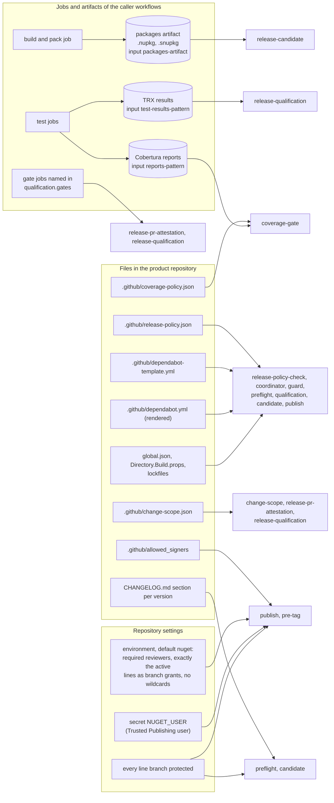

## 3. The release policy and who reads it

`.github/release-policy.json` is read from the current head of protected
`main` through the API whenever a step grants something (dispatch, admission,
publication). The pull request check takes the allowed base lines from that
copy on `main` and checks the toolchain and `dependabot.yml` against the
checkout's own copy, so a pull request can change the policy.

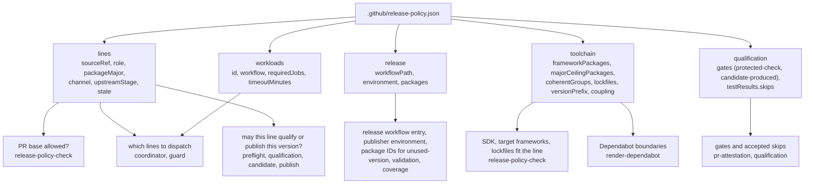

## 4. Release lines

Each line is one branch. Role, ref, channel and upstream stage are tied
together (`_line` in `tools/release_lines/policy.py`); the state decides what
the line may be used for (`PURPOSES`). Changing a line is a pull request
against `main`; the policy prescribes no order of states.

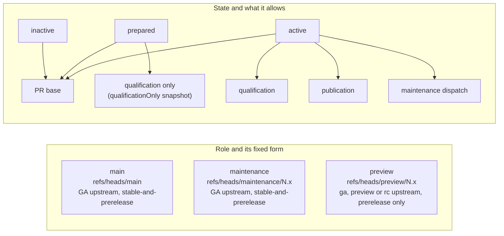

Exactly one main line; every `sourceRef` once; at most one active line per
package major, so two branches never publish into the same versions; a
version must have the major of its line.

## 5. Pull request

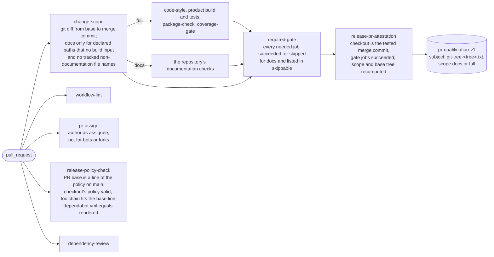

The attestation is what a later release of a commit with the same tree relies
on; it does not expire like an artifact. A required check whose workflow a path
filter skips stays pending, so the CI workflow always starts and only its jobs
are skipped.

## 6. Checks of every change in detail

```mermaid
flowchart TB
  subgraph lintbox["workflow-lint"]
    l1["actionlint 1.7.12, checksum-verified"] --> l2["zizmor 1.32.0 from hash-pinned<br/>requirements, offline, persona regular"] --> l3["shellcheck on every tracked *.sh,<br/>severity warning"]
  end

  subgraph reviewbox["dependency-review"]
    r1["dependency-review-action<br/>fail-on-severity, allow-licenses,<br/>license exceptions as allowed packages"] --> r2{"license exceptions set?"}
    r2 -- yes --> r3["read the dependency comparison base...head<br/>from the API, every page"] --> r4["an added package that matches an exception<br/>must be NuGet at exactly the reviewed version"]
    r2 -- no --> r5(["done"])
  end

  subgraph auditbox["dependency-audit (scheduled workload)"]
    a1["solution of every project file,<br/>NuGet.Config with nuget.org only"] --> a2["restore --force --no-http-cache,<br/>locked mode, audit all, level low,<br/>NU1900-NU1905 as errors"] --> a3["dotnet package list --vulnerable<br/>--include-transitive, JSON v1"] --> a4["no diagnostics, every project listed,<br/>no vulnerable package"] --> a5[("evidence artifact<br/>dependency-audit-&lt;run&gt;-&lt;attempt&gt;")]
  end

  subgraph covbox["coverage-gate"]
    c1["merge Cobertura reports line by line,<br/>source paths from /src/ on"] --> c2["no empty report,<br/>optional maximum age"] --> c3["every release package has a threshold<br/>and executed lines"] --> c4["line and branch floors per assembly<br/>and per critical class; branch floor null<br/>only for a branch-free surface"]
  end
```

## 7. Release-line guard

The first job of a workload decides whether the rest may run.

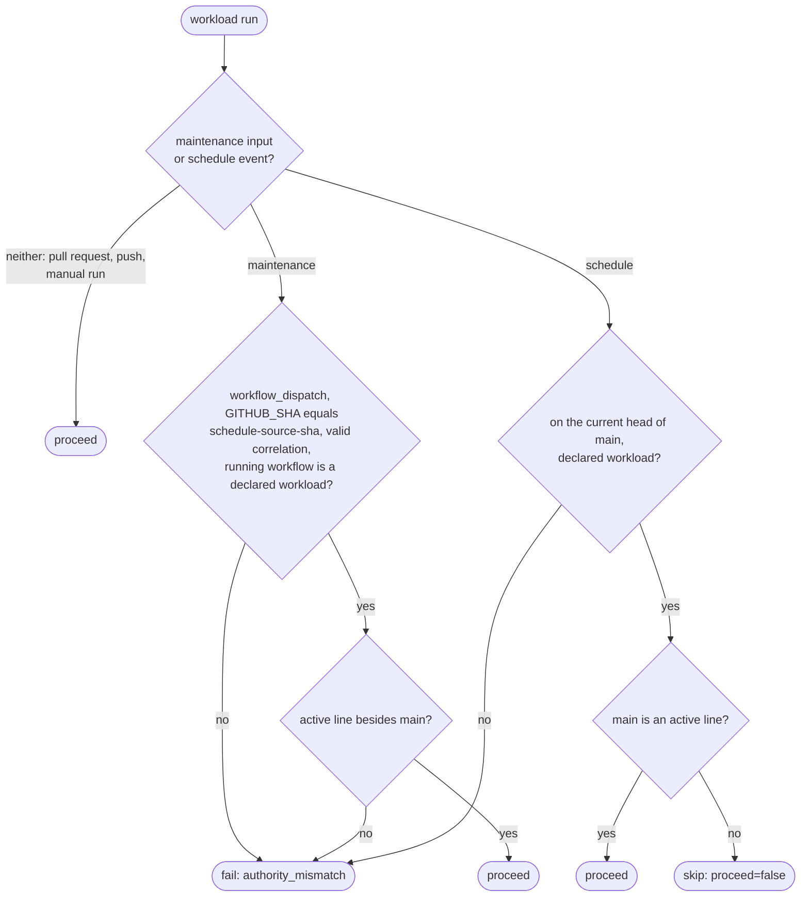

## 8. Scheduled maintenance of all active lines

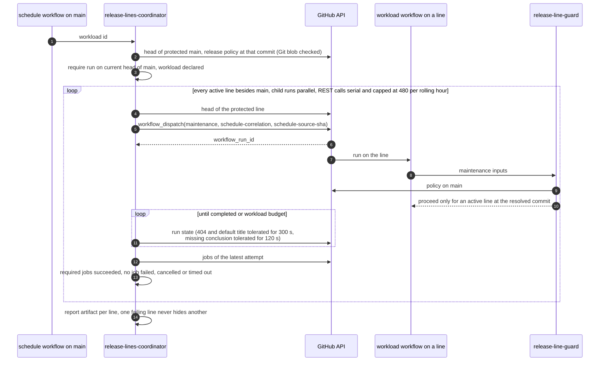

## 9. Release run

One run per version, started by `workflow_dispatch` on the line's branch. A
later run of the same version finds the draft and continues at publication.

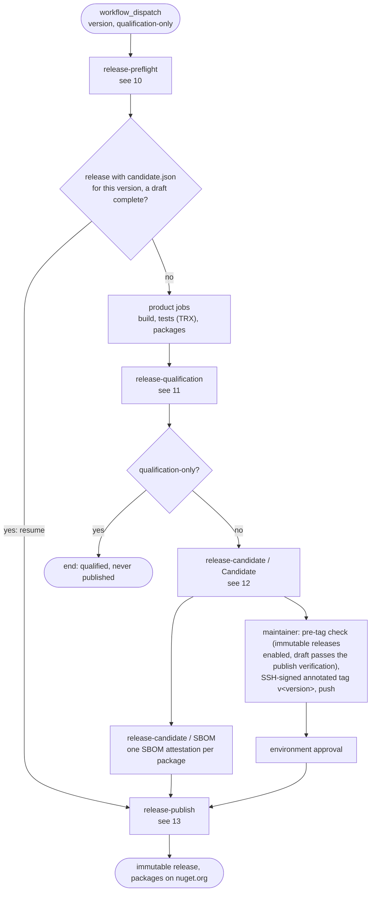

## 10. Preflight

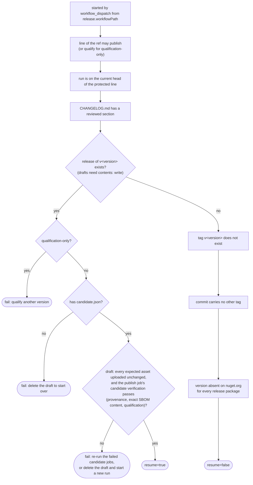

## 11. Qualification

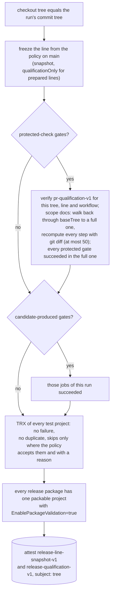

## 12. Candidate job

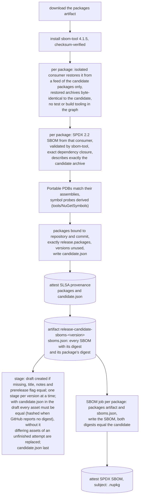

## 13. Publish job

Every irreversible write is preceded by a full recheck. A stop anywhere is
resumed by re-running the job: what nuget.org and the draft already hold is
observed, never replaced.

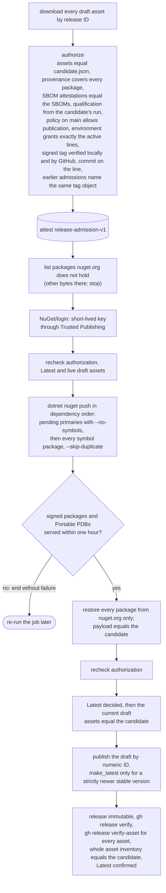

## 14. Data between jobs

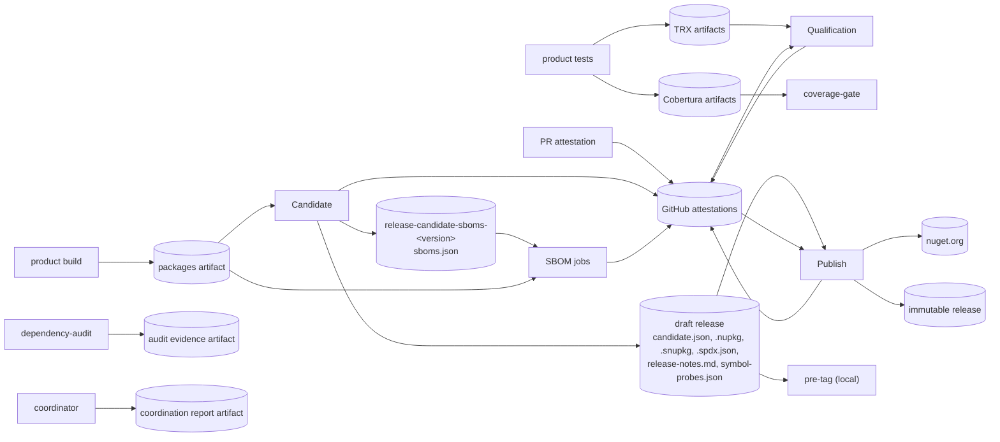

Artifacts live only as long as the retention setting; everything a later run
relies on is an attestation or a release asset.

## 15. Permissions

Each job asks for the least the API calls need; the top-level default of every
workflow is `contents: read`.

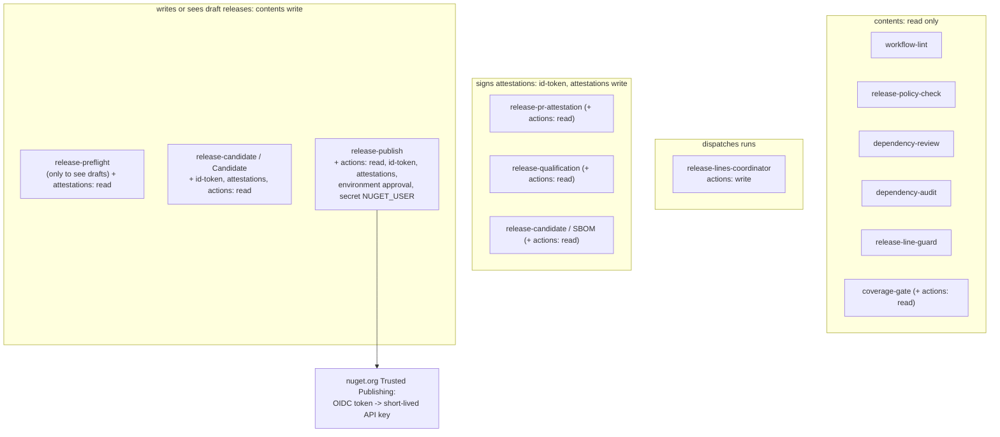

## 16. Failure and resume

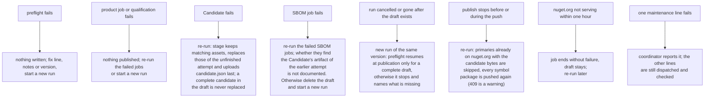

## 17. Attestations and what checks them

All attestations are signed by a reusable workflow of this repository, so
`gh attestation verify --signer-workflow` accepts nothing else.

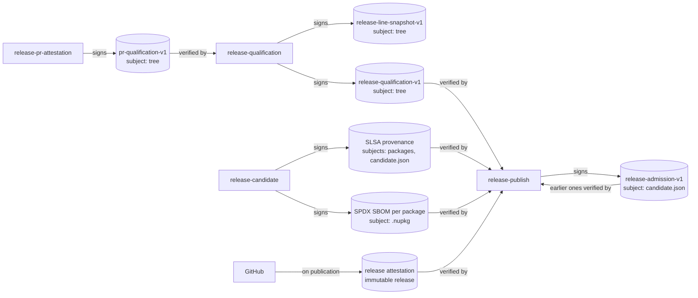

## 18. Dependabot configuration

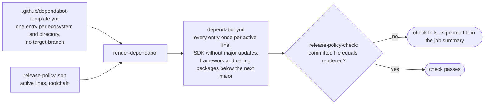

## 19. This repository itself

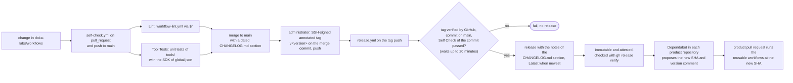
